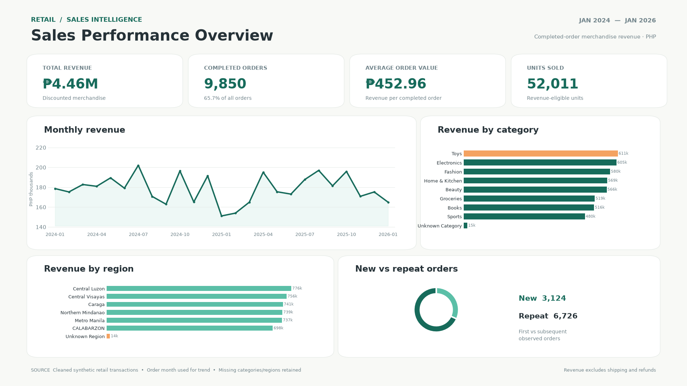

# Retail Sales Performance & Customer Insights

**Python Data Analytics Capstone | Sales Performance & Customer Insights**

An end-to-end analysis of a **synthetic Philippine retail dataset**, using Python to clean and integrate transactional data, validate sales KPIs, investigate customer purchasing patterns, and communicate business recommendations.



## Executive summary

Across **15,000 orders** dated January 2024–January 2026, the analysis identifies **9,850 completed orders** and **₱4,461,673.07** in completed-order merchandise revenue, with an **average order value of ₱452.96**. Revenue was spread across product categories and regions, while cancellations and returns indicate opportunities for operational investigation. This project uses simulated data; findings are illustrative, not claims about a real retailer.

| Key performance indicator | Result |
| --- | ---: |
| Completed-order merchandise revenue | ₱4,461,673.07 |
| Total orders | 15,000 |
| Completed orders | 9,850 |
| Average order value | ₱452.96 |
| Revenue-eligible units sold | 52,011 |
| Cancelled orders | 1,235 (8.23%) |
| Returned orders | 578 (3.85%) |

## Business questions

- How is completed-order revenue changing over time?
- Which products, categories, and customer regions generate the most revenue?
- How is customer spending distributed, and how many completed orders are first-observed versus repeat orders?
- What patterns emerge in cancellations and returns?

## Data and methodology

Seven original CSV datasets cover **customers, products, orders, order items, payments, shipments, and returns**. The analysis audits row counts, data types, duplicates, missing values, inconsistent categories, dates and currency formats, and invalid join keys. Cleaning rules and exceptions are documented in the notebook and capstone report. Cleaned CSV exports are included for reproducibility.

The analytical **sales fact table** uses an **order-item grain**, combining order items with order, product, and customer attributes. Revenue is calculated as:

`quantity × unit_price_at_purchase × (1 − discount_pct_for_analysis)`

Revenue includes **completed orders with valid positive-quantity items and available prices**. It excludes shipping charges and does **not** subtract refunds. Average order value is revenue divided by the count of completed orders. Missing categories and regions are retained as unknown groups rather than silently dropped.

For the new/repeat analysis, **new** denotes the first observed order for a customer in the available data, while **repeat** denotes subsequent observed orders. This is not a lifetime acquisition or retention metric.

## Selected findings

1. **Revenue:** 2024 completed-order revenue was **₱2,174,844.01**, versus **₱2,121,862.45** in 2025 (**−2.44%**).
2. **Product concentration:** The top 10 products contributed **₱184,750.83**, or **4.14%** of total revenue; the highest-revenue product was **KidJoy Toys 607**.
3. **Category mix:** **Toys** led with **₱610,562.72 (13.68%)**, narrowly ahead of Electronics. No identified category accounted for more than 14% of revenue.
4. **Geography:** **Central Luzon** led at **₱776,432.08 (17.40%)**; unknown-region revenue was retained for reconciliation.
5. **Customer spending:** Among **4,307 customers with positive revenue**, median spending was approximately **₱882**, below the mean of approximately **₱1,036**, indicating a right-skewed distribution.
6. **Order behavior:** **3,124 completed orders** were first-observed orders and **6,726** were subsequent orders under the dataset-based classification.
7. **Order outcomes:** **8.23%** of all orders were cancelled and **3.85%** were returned; monthly trends warrant further investigation rather than assumptions about causes.

## Recommendations

1. **Monitor performance monthly:** Track completed-order revenue, completed orders, AOV, category mix, and regional results; investigate shifts before making inventory or marketing decisions.
2. **Investigate cancellations and returns:** Break down affected orders by product, region, fulfillment stage, and reason (where available) to identify actionable operational issues.

## Visualizations

- [Monthly revenue trend](outputs/figures/monthly_revenue_trend.png)
- [Top 10 products by revenue](outputs/figures/top_10_products_revenue.png)
- [Revenue by region](outputs/figures/regional_revenue.png)
- [Customer spending distribution](outputs/figures/customer_spending_distribution.png)
- [Monthly cancellations and returns](outputs/figures/monthly_cancellations_returns.png)
- [Executive dashboard (1920 × 1080)](outputs/figures/retail_executive_dashboard_1920x1080.png)

## Project structure

```text
retail-sales-customer-insights/
├── data/
│   ├── raw/                 # Seven original CSVs and data dictionary
│   └── cleaned/             # Seven cleaned CSVs
├── notebooks/
│   ├── retail_sales_analysis.ipynb
│   └── retail_sales_dashboard.ipynb
├── outputs/
│   └── figures/             # Five charts and executive dashboard
├── reports/
│   ├── Retail_Sales_Capstone_Report.pdf
│   └── Retail_Sales_Insights_Summary.pdf
├── .gitignore
└── README.md
```

## Reproduce the analysis

1. Install Python and Jupyter, along with **pandas, numpy, and matplotlib**.
2. Keep the `data/raw/`, `data/cleaned/`, `notebooks/`, and `outputs/figures/` directories in the structure above.
3. Open `notebooks/retail_sales_analysis.ipynb` and run all cells from a fresh kernel to regenerate cleaning outputs, KPIs, and five charts.
4. Open `notebooks/retail_sales_dashboard.ipynb` and run all cells to regenerate the 1920 × 1080 dashboard.
5. Review the final notebook validation results and compare them with the reported KPI totals.

The notebooks use relative paths intended for execution from the `notebooks/` directory. This repository contains **synthetic sample data**; no real customer data is represented.

## Reports

- [Full capstone report (PDF)](reports/Retail_Sales_Capstone_Report.pdf)
- [One-page insights summary (PDF)](reports/Retail_Sales_Insights_Summary.pdf)

## Tools

**Python · pandas · NumPy · Matplotlib · Jupyter Notebook · GitHub**

---
*Prepared as a DataSense Analytics Python capstone and portfolio project.*
